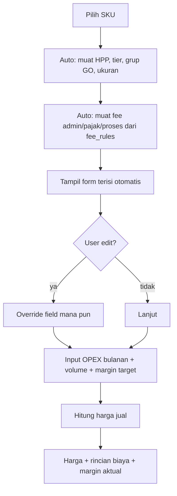

# Rancangan — Hitung Harga Jual (v2, disederhanakan)

Status: **DRAFT v2 → DIIMPLEMENTASI (2026-10-13)** · Menggantikan v1 (`2026-10-13-hitung-harga-jual.md` bagian BOP → sekarang **OPEX manual**).
Prinsip: **auto yang bisa diotomatiskan, manual yang memang perlu keputusan manusia.** Jangan paksa otomatis.

## Status Implementasi

| Komponen | File | Status |
|---|---|---|
| Mesin hitung | `lib/laba/hitungHargaJual.ts` | ✅ 12/12 test |
| Adapter resolusi auto | `lib/d1/hargaJualPreset.ts` | ✅ |
| API | `app/api/harga-jual/route.ts` | ✅ |
| Halaman | `app/harga-jual/page.tsx` | ✅ + menu nav |
| Verifikasi data nyata | SKU 100331, preset 2 | ✅ (lihat §10) |
| Test regresi laba | `lib/laba/laba.test.ts` | ✅ 25/25 |

## Rumus FINAL (disetujui owner)

```
opex_unit = OPEX_non-iklan ÷ volume_bulanan        ← NOMINAL (biaya tetap)
harga     = (hpp + opex_unit + flat_per_unit) ÷ (1 − fee_persen − iklan_persen − margin)
```

**Kenapa OPEX nominal, bukan persen:** OPEX itu biaya tetap — gaji & sewa tidak naik saat harga jual naik. Kalau OPEX dijadikan persen omzet, ia ikut menskalakan diri dan **kurang tertutup** saat harga naik. Iklan tetap persen karena memang variabel.

**Rumus yang DITOLAK** (usulan awal owner) dan alasannya:
`Harga = HPP ÷ (1 − Admin% − OPEX% − Iklan% − Margin%)`
→ mencampur basis: `OPEX%` mengacu omzet sedangkan pembilangnya HPP. Dengan HPP Rp5.000 & OPEX omzet 11,66%, OPEX yang tertanggung hanya Rp1.344 sementara OPEX riil Rp2.384/unit — **kurang Rp1.040/unit** (Rp12 juta/bulan di volume 11.577).


---

## 1. Prinsip Desain

| Komponen | Sumber | Bisa diedit user? |
|---|---|---|
| **HPP** | Auto dari `products.hpp` (SKU terpilih) | Ya |
| **Fee admin** | **Auto dari `fee_rules`** berdasarkan tier SKU | **Ya** (override manual) |
| **Fee program** (GO/promo) | Auto dari `fee_rules` + `preset_program` aktif | Ya |
| **Pajak** | Auto dari `fee_rules` jenis `pajak_pph`/`pajak_ppn` | Ya |
| **Biaya flat** (proses) | Auto dari `fee_rules` unit `per_order` | Ya |
| **OPEX** | **INPUT MANUAL** (angka bulanan, user ketik) | Selalu manual |
| **Volume** | **INPUT MANUAL** (unit/bulan) | Selalu manual |
| **Margin target** | **INPUT MANUAL** | Selalu manual |

Alasan OPEX & volume manual: keduanya bergantung pada keputusan bisnis pemilik (berapa ekspektasi jualan bulan depan), bukan data transaksi historis. Memaksakan auto akan salah saat kondisi berubah.

## 2. Alur



## 3. Rumus

```
opex_per_unit = OPEX_bulanan / volume_bulanan
c             = HPP + opex_per_unit
fee_persen    = (admin + program + pajak + iklan_persen) / 100
harga         = c / (1 − fee_persen − margin_target)
```

**Biaya flat** (per order, mis. proses Rp1.250) tidak masuk penyebut. Perlakukan sebagai pengurang langsung:
```
harga = (c + flat_per_order) / (1 − fee_persen − margin_target)
```

**Catatan:** kalau 1 order berisi N unit, `flat_per_order` dibagi N agar adil:
`flat_per_unit = flat_per_order / rata2_qty_per_order`.

### Contoh nyata — SKU 100331 (Pisau Set 3 in 1)

Data D1: HPP Rp5.000, tier T10, GO grup D, ukuran biasa.

| Komponen | Nilai | Sumber |
|---|---|---|
| HPP | Rp5.000 | auto `products.hpp` |
| Admin T10 | 10,00% | auto `fee_rules` |
| GO Xtra D biasa | 5,50% | auto `fee_rules` |
| Promo Xtra Plus | 6,50% | auto `fee_rules` |
| Pajak PPh | 0,50% | auto `fee_rules` |
| **Fee total** | **22,50%** | |
| Biaya proses | Rp1.250/order | auto `fee_rules` |
| OPEX | input manual | manual |
| Volume | input manual | manual |

Dengan OPEX Rp33.450.515 ÷ 11.577 unit = Rp2.889 (ikut iklan), margin 15%:

| Margin target | Harga jual | vs aktual (Rp10.879) |
|---|---|---|
| 10% | Rp11.355 | +Rp476 |
| 15% | Rp12.301 | +Rp1.422 |
| 20% | Rp13.418 | +Rp2.539 |

## 4. Yang Harus Auto (dari `fee_rules`)

Untuk SKU terpilih, sistem melakukan resolusi aturan yang **sudah ada** di `lib/laba/aturanBiaya.ts` (`pilihAturan`) dan `lib/laba/kategori.ts` (`resolveTier`):

| Field | Cara ambil |
|---|---|
| tier | `resolveTier(products.kategori, products.tier_override, kategori_tarif)` |
| grup GO | `products.go_override` ?? `kategori_tarif.grup_go` |
| ukuran | `products.ukuran_khusus` → `'khusus'` / `'biasa'` |
| fee admin | `pilihAturan(rules, {jenis:'admin', kategori:tier})` |
| fee program | `pilihAturan` per `kode_program` yang **aktif** di `preset_program` |
| pajak | `pilihAturan(rules, {jenis:'pajak_pph'\|'pajak_ppn'})` |
| flat | `rules.filter(unit === 'per_order')` |

**Yang perlu dijaga:** kalau kategori SKU belum dipetakan (`TIER_UNKNOWN`), **jangan** diam-diam pakai `admin *` 22,5% (itu fallback `belum_diverifikasi`). Tampilkan peringatan "tier tidak diketahui — admin harus diisi manual" dan kosongkan field admin.

## 5. Bentuk Data Hasil Hitung

Tidak perlu tabel baru untuk perhitungan. Cukup:
```ts
type HitungHarga = {
  sku: string; nama: string | null; hpp: number;
  // auto dari fee_rules, tapi bisa ditimpa user
  admin_persen: number; program: { kode: string; persen: number }[]; pajak_persen: number;
  flat_per_order: number;
  // manual
  opex_bulanan: number; volume_bulanan: number; margin_target: number;
  // hasil
  opex_per_unit: number; fee_persen_total: number;
  harga: number; margin_rupiah: number; margin_aktual_persen: number;
  rincian: { nama: string; nilai: number; rupiah: number }[];
  peringatan: string[];
};
```

Simpan riwayat perhitungan (opsional, tapi berguna):
```sql
-- 0020_harga_jual.sql
CREATE TABLE IF NOT EXISTS harga_jual_simulasi (
  id INTEGER PRIMARY KEY AUTOINCREMENT,
  preset_id INTEGER REFERENCES seller_presets(id) ON DELETE CASCADE,
  sku TEXT NOT NULL REFERENCES products(sku),
  hpp INTEGER NOT NULL,
  opex_bulanan INTEGER NOT NULL,
  volume_bulanan INTEGER NOT NULL,
  margin_target REAL NOT NULL,
  fee_persen_total REAL NOT NULL,
  harga_hasil INTEGER NOT NULL,
  rincian_json TEXT NOT NULL DEFAULT '[]',
  manual_json TEXT NOT NULL DEFAULT '{}',   -- field yang di-override user
  at INTEGER NOT NULL DEFAULT (unixepoch()),
  by TEXT
);
```

## 6. UI

**Halaman `/harga-jual`** — satu halaman, sederhana:

1. **Pilih preset + SKU** (dropdown/search). Setelah pilih, form terisi otomatis.
2. **Panel "Biaya Shopee"** (auto, bisa edit):
   - Admin: `10,00%` ← badge "dari fee_rules (T10)". Klik → bisa diubah, muncul badge "manual".
   - GO Xtra: `5,50%` ← badge auto + toggle program.
   - Promo Xtra Plus: `6,50%` ← badge auto.
   - Pajak: `0,50%` ← badge auto.
   - Biaya proses: `Rp1.250` ← badge auto.
3. **Panel "Operasional"** (manual):
   - OPEX bulanan: `[______]` + bantuan "contoh: sewa + gaji + packing"
   - Volume bulanan: `[______]` + tampil hasil "OPEX/unit: Rp2.889"
4. **Margin target**: input % atau Rp.
5. **Hasil**: harga jual besar di atas, tabel rincian biaya per baris, margin aktual.
6. **Badge peringatan**: HPP basi, fee belum terverifikasi, tier tak diketahui, margin mustahil (>100%−fee).

**Tanda sumber nilai** wajib jelas: setiap field auto punya label kecil "auto" / "manual". Ini krusial supaya user tahu mana yang dia ubah.

## 7. Keputusan yang Sudah Diambil

| # | Keputusan |
|---|---|
| 1 | OPEX = **input manual** setiap perhitungan (tidak disimpan sebagai master) |
| 2 | Volume = **input manual** |
| 3 | Fee admin/pajak/proses = **auto dari `fee_rules`**, boleh di-override |
| 4 | Fee program = auto dari program yang aktif di preset, boleh di-toggle |
| 5 | Harga jual = rumus `(hpp + opex_unit + flat) / (1 − fee% − margin)` |
| 6 | Iklan: masuk atau tidak ke fee, **diputuskan user** (checkbox "sudah termasuk OPEX") |

## 8. Task

### Fase A — Mesin hitung (murni, tanpa D1)
- **A1** `lib/laba/hitungHargaJual.ts`: fungsi murni `hitungHargaJual(input) → output` + test. Menangani: fee persen, flat per order, margin %, kasus mustahil (`fee + margin >= 1`), pembulatan opsional.
- **A2** Test: SKU 100331 (kasus nyata), margin 10/15/20, fee+margin >100% (harus error jelas), flat per order, override manual.

### Fase B — Resolusi otomatis (D1)
- **B1** `lib/d1/hargaJualPreset.ts`: `muatKomponenHarga(db, presetId, sku)` → pakai `resolveTier` + `pilihAturan` yang sudah ada → kembalikan `{hpp, tier, admin, program[], pajak, flat, peringatan[]}`. Plus test.
- **B2** `app/api/harga-jual/route.ts`: `GET ?aksi=komponen&presetId=&sku=` (auto-isi), `POST aksi=hitung` (hitung dari input user).

### Fase C — Migrasi (opsional)
- **C1** Migrasi `0020_harga_jual.sql`: tabel `harga_jual_simulasi` (riwayat). Bisa ditunda kalau belum perlu.
- **C2** `GET aksi=riwayat` + simpan.

### Fase D — UI
- **D1** `app/harga-jual/page.tsx`: form auto-terisi + edit + OPEX/volume manual + hasil.
- **D2** Badge sumber nilai ("auto" / "manual") di tiap field.
- **D3** Export CSV (opsional).

### Fase E — Verifikasi
- **E1** Uji nyata SKU 100331 dengan fee_rules produksi → harga harus cocok dengan hitungan manual (Rp11.355 / Rp12.301 / Rp13.418).
- **E2** tsc + test + build + deploy.

## 9. Batas yang Disengaja

- **Tidak** menghitung fee per SKU secara otomatis dari data historis — itu ambigu (fee mana yang benar-benar terpakai per order). Fee diambil dari **konfigurasi** (`fee_rules`), yang memang sumbernya keputusan owner.
- **Tidak** menyimpan OPEX sebagai master — user mengetik tiap kali. Kalau nanti terasa berulang, baru tambahkan preset OPEX.
- **Tidak** memaksa otomatis untuk tier tak dikenal — lebih baik tampil peringatan daripada harga salah.

## 10. Verifikasi Data Nyata (SKU 100331, preset 2 "TokoHanaa")

Resolusi otomatis dari `fee_rules` produksi:

| Sumber | Jenis | Nilai |
|---|---|---|
| auto | Admin T10 | 10,00% |
| auto | gratis_ongkir_xtra (grup D, biasa) | 5,50% |
| auto | promo_xtra_plus | 6,50% |
| auto | pajak_pph | 0,50% |
| auto | proses (flat/order) | Rp1.250 |
| **total fee** | | **22,50%** |

HPP Rp5.000, OPEX Rp33.450.515 ÷ 11.577 unit = Rp2.889/unit, iklan 2,47%:

| Margin target | Harga jual (bulat 500) | Margin aktual |
|---|---|---|
| 10% | Rp14.000 | 9,75% |
| 15% | Rp15.000 | 14,10% |
| 20% | Rp16.500 | 19,64% |

**Harga jual aktual dari snapshot produksi: Rp10.879.** Artinya SKU ini dijual **di bawah titik aman** — pada margin 10% pun butuh Rp14.000, sedangkan harga sekarang Rp10.879 (selisih Rp3.121/unit).

Catatan: fee persen SKU ini **22,50%**, sementara rata-rata tertimbang seluruh SKU dari snapshot **28,17%** — selisih wajar karena SKU lain berada di grup GO berbeda (E–H: 6–9,5%) dan sebagian masuk ukuran khusus.

## 11. Peringatan Desain yang Dipertahankan

1. **Tier tak dikenal → field admin dikosongkan**, bukan diam-diam memakai `admin *` (22,5%, `belum_diverifikasi`). Lebih baik peringatan daripada harga salah.
2. **Program berplafon** (`plafon_per_qty`) memunculkan peringatan "harga belum memperhitungkan plafon" — rumus belum mengiterasi plafon.
3. **Iklan vs OPEX** — aplikasi memunculkan peringatan bila keduanya diisi > 0, untuk mencegah dobel hitung.
