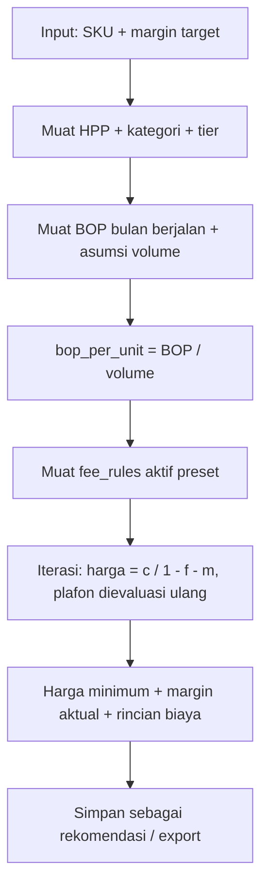

# Rancangan — Fitur "Hitung Harga Jual Shopee"

Status: DRAFT v1 (2026-10-13) · Basis: mesin laba yang sudah ada (`lib/laba/*`, tabel `fee_rules`/`tier_admin`/`kategori_tarif`/`seller_presets`)
Tujuan: menghitung harga jual yang **sudah memperhitungkan BOP** (biaya operasional bulanan), supaya laba bersih nyata, bukan laba kotor.

---

## 1. Masalah

Mesin laba sekarang menghitung **laba** dari data historis:
```
laba = omzet − hpp − biaya_fee_shopee − pajak
```
Yang belum ada: **BOP** (biaya operasional tetap bulanan: gaji, sewa, listrik, internet, packing, dll). Akibatnya laba yang tampil = laba **kotor**, bukan laba bersih. Angka bisa terlihat untung padahal setelah BOP rugi.

Yang dibutuhkan sekarang: arah **kebalikan** — dari HPP + BOP, hitung **harga jual minimum** yang masih memberi margin target.

## 2. Rumus (inti)

Semua biaya Shopee bersifat **persentase dari harga jual** (admin tier, program, pajak) — jadi tak bisa sekadar "HPP + BOP + margin". Harus diselesaikan secara aljabar.

### 2.1 BOP per unit

BOP alokasi per unit bergantung **perkiraan volume bulanan**:
```
bop_per_unit = BOP_bulanan / perkiraan_unit_terjual_bulanan
```
Ini titik paling sensitif: kalau volume salah tebak, BOP per unit ikut salah. Karena itu volume **wajib input manual** (bukan asumsi), dan tersimpan sebagai riwayat.

### 2.2 Harga jual minimum (margin sebagai persen dari harga)

Misal `f` = total persentase biaya Shopee (admin + program + pajak, dalam desimal), `m` = margin target (desimal), `c` = HPP + BOP per unit:

```
harga = c / (1 − f − m)
```

**Contoh nyata** (memakai pola data toko: HPP Rp10.000, fee total 12%, margin target 15%):
- BOP bulanan Rp30.000.000 ÷ 3.000 unit = Rp10.000/unit
- c = 10.000 + 10.000 = Rp20.000
- f = 0,12 ; m = 0,15
- harga = 20.000 / (1 − 0,27) = **Rp27.397** → dibulatkan Rp27.500

Verifikasi: harga 27.500 → fee 12% = 3.300 → sisa 24.200 − c 20.000 = **margin 4.200 (15,3%)** ✓

### 2.3 Harga jual minimum (margin sebagai persen dari HPP, markup)

Kalau targetnya "untung X% dari modal":
```
margin_rupiah = c × markup
harga = (c + margin_rupiah) / (1 − f)
```

### 2.4 Kasus fee flat / per-order

Biaya `flat` (mis. biaya proses Rp1.250/order) tidak masuk rumus persen. Perlakukan sebagai komponen tetap:
```
harga = (c + flat_per_order_share) / (1 − f)
```
`flat_per_order_share` = total flat per order ÷ rata-rata qty per order.

### 2.5 Plafon fee

Aturan dengan `plafon` (mis. komisi maks Rp650.000) **tidak bisa** dimasukkan ke rumus tertutup — ia bergantung pada harga hasil, sedangkan harga dicari. Penyelesaian: **iterasi** (2-3 putaran cukup, karena fungsi plafon monoton):
1. hitung `harga₀` tanpa plafon
2. evaluasi fee dengan plafon terhadap `harga₀`
3. hitung ulang `harga₁` dengan fee hasil evaluasi
4. ulangi sampai selisih < Rp1

Bandingkan dengan mesin laba yang ada: `feePersen(dasar, persen, plafon)` sudah menangani plafon satu arah. Fungsi harga jual cukup memanggilnya berulang.

## 3. BOP sebagai data (bukan rumus)

BOP **bukan** `fee_rules` — ia bukan biaya per transaksi Shopee, melainkan biaya internal yang harus dialokasikan. Dua pilihan:

### Opsi A (dipilih) — tabel BOP terpisah

```sql
-- 0020_bop.sql
CREATE TABLE IF NOT EXISTS bop_bulanan (
  id          INTEGER PRIMARY KEY AUTOINCREMENT,
  preset_id   INTEGER REFERENCES seller_presets(id) ON DELETE CASCADE, -- NULL = global (semua preset)
  periode     TEXT NOT NULL,            -- YYYY-MM (bulan berlaku)
  nama        TEXT NOT NULL,            -- "Gaji", "Sewa", "Listrik", ...
  nominal     INTEGER NOT NULL CHECK (nominal >= 0),
  catatan     TEXT,
  at          INTEGER NOT NULL DEFAULT (unixepoch()),
  by          TEXT
);
CREATE UNIQUE INDEX IF NOT EXISTS idx_bop_unik ON bop_bulanan(preset_id, periode, nama);

-- Riwayat asumsi volume: dasar alokasi BOP per unit.
CREATE TABLE IF NOT EXISTS volume_asumsi (
  id          INTEGER PRIMARY KEY AUTOINCREMENT,
  preset_id   INTEGER REFERENCES seller_presets(id) ON DELETE CASCADE,
  periode     TEXT NOT NULL,
  unit_target INTEGER NOT NULL CHECK (unit_target > 0),
  sumber      TEXT,                     -- "histori", "target", "manual"
  at          INTEGER NOT NULL DEFAULT (unixepoch()),
  by          TEXT
);
CREATE UNIQUE INDEX IF NOT EXISTS idx_volume_unik ON volume_asumsi(preset_id, periode);
```

Alasan memilih tabel terpisah: BOP punya **periode bulanan** dan **item berulang** (gaji/sewa tiap bulan), sedangkan `fee_rules` punya `valid_from`/`valid_to` per baris dan ikut kalkulasi per-transaksi. Mencampur keduanya membuat mesin laba per-transaksi ikut menghitung biaya bulanan — salah model.

### Opsi B (ditolak) — masukkan ke `fee_rules` sebagai `jenis='bop'`, `basis='persen'`

Ditolak karena: persentase BOP **bukan** tarif tetap, ia hasil pembagian BOP÷volume yang berubah-ubah. Menyimpannya sebagai persen statis berarti angka basi begitu volume berubah.

## 4. Alur fitur



**Tahap:**
1. **Pilih preset + periode** (bulan) → ambil BOP aktif + volume asumsi.
2. **Pilih SKU** (satu, banyak, atau semua yang punya HPP).
3. **Tentukan target**: margin % dari harga jual, ATAU markup % dari modal, ATAU laba rupiah per unit.
4. **Hitung** (fungsi murni, tanpa D1 — pola sama seperti `hitungLabaPreset`).
5. **Tampilkan**: harga minimum, harga dibulatkan (opsi: ke 500/1000 terdekat), rincian (HPP, BOP/unit, tiap fee, pajak, margin), peringatan (fee belum terverifikasi, HPP basi, BOP belum diisi).
6. **Simpan/export**: rekomendasi tersimpan per (preset, SKU, periode) + CSV.

## 5. Blokir vs Peringatan

| Blokir | Peringatan |
|---|---|
| Volume asumsi 0/kosong (pembagi nol) | BOP bulan ini kosong → harga tanpa BOP (ditandai jelas) |
| SKU tanpa HPP | Fee `belum_diverifikasi` (pakai flag `estimasi_kasar` yang sudah ada) |
| `f + m >= 1` (rumus tak terdefinisi / mustahil) | HPP basi >30 hari (badge sudah ada) |
| SKU belum dipetakan kategori (tier tak diketahui) | Margin hasil < margin target (karena pembulatan) |

## 6. Task

### Fase A — Data
- **A1** Migrasi `0020_bop.sql`: `bop_bulanan`, `volume_asumsi`. Apply lokal + remote.
- **A2** `lib/d1/bop.ts`: CRUD `bop_bulanan` + `volume_asumsi`, `bopPerUnit(db, presetId, periode)` → `{ total, volume, perUnit, adaData }`. Plus test.

### Fase B — Mesin hitung
- **B1** `lib/laba/hitungHargaJual.ts` (murni, tanpa D1): `hitungHargaJual({ hpp, bopPerUnit, rules, tier, target: {mode: 'margin'|'markup'|'laba', nilai}, plafonIterasi? })` → `{ harga, marginAktual, rincian[], peringatan[] }`. Menangani: fee persen per baris, fee flat per order, plafon (iterasi), pajak, kombinasi. Plus test dengan kasus: plafon aktif, fee flat, margin mustahil, margin 0.
- **B2** `lib/d1/hargaJualPreset.ts`: adapter — muat SKU + kategori + tier + fee + BOP → panggil mesin → kembalikan daftar rekomendasi.

### Fase C — API & UI
- **C1** `app/api/harga-jual/route.ts`: `GET ?aksi=hitung&presetId=&periode=&sku=&target=`, `POST aksi=simpan`, `GET aksi=export-csv`.
- **C2** `app/harga-jual/page.tsx`: input target, tabel hasil per SKU (harga minimum, harga dibulatkan, margin, rincian biaya), filter kategori/tier, badge peringatan.
- **C3** Panel BOP di `app/pengaturan/page.tsx` (atau halaman baru): input BOP bulanan per item + asumsi volume.

### Fase D — Verifikasi
- **D1** Unit: rumus (margin/markup/laba), plafon iterasi konvergen, fee flat, kasus mustahil.
- **D2** Uji nyata: pakai HPP + kategori dari D1 produksi, bandingkan hasil dengan laba historis (harga jual nyata vs harga minimum — apakah toko sudah di atas/bawah titik aman).
- **D3** E2E + build + deploy.

## 7. Keputusan Owner

1. **Basis margin**: margin % dari harga jual (standar marketplace) atau markup % dari modal? (rumus 2.2 vs 2.3)
2. **Volume asumsi**: input manual per bulan, atau tarik otomatis dari rata-rata order 30 hari terakhir?
3. **BOP global atau per preset**: toko punya beberapa preset — BOP dibagi semua preset (global) atau dihitung per preset?
4. **Pembulatan harga**: ke 500, 1.000, atau tanpa pembulatan (tampil apa adanya)?
