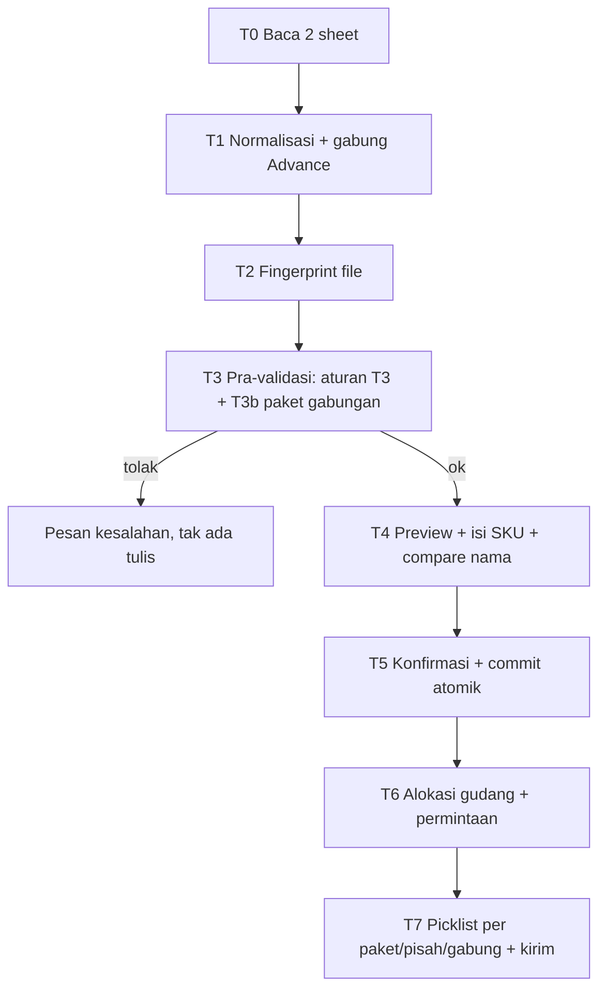

# Rancangan Teknis — Import Order.toship + Advance Fulfilment

Status: DRAFT v2 (2026-10-13) · Basis: riset 20 file export nyata di `C:\Users\Hanaa\Documents\Data` + artikel resmi Shopee 7089 (F18)
Sumber data: `Order.toship.*` (orders 49 kolom + Advance Fulfilment 11 kolom), `Order.all.*` (referensi laba), `Order.shipping.*` (sudah dikirim).

## 0. Fakta Hasil Riset (dasar keputusan)

| # | Temuan | Bukti | Implikasi |
|---|---|---|---|
| F1 | Kolom `SKU Induk` ≠ `Nomor Referensi SKU`; Referensi = varian, Induk = produk | 201 baris punya keduanya; 19 beda nilai (`001485` vs `100012`) | Peta SKU: Referensi dulu → fallback Induk. Sudah benar di kode, pertahankan |
| F2 | `SKU Induk` sering kosong, Referensi ada | 621 baris (induk kosong, ref ada); 0 baris sebaliknya | Aman pakai referensi |
| F3 | Baris tanpa SKU dua-duanya = 30% | 1283/4282 baris (semua file) | Wajib UI pengisian SKU manual + tebak nama |
| F4 | File `Order.all.20261005` export rusak | 307 baris, kolom 8-50 `None`, Nama Produk kosong | Tolak file di depan (deteksi kolom produk kosong) |
| F5 | `Advance Fulfilment`: 1 baris = 1 Booking SN, qty 1 | 454 baris = 454 SN unik; multi-baris = 0 (2 file) | Kode `addItem(sku,1,0,0)` benar; yang salah = Booking SN dipakai sebagai `no_pesanan` |
| F6 | `Booking SN` & resi Advance **tidak beririsan** dengan `No. Pesanan`/resi sheet orders | irisan 0 di 3 file | Advance = dokumen pasokan terpisah, bukan pelengkap per order |
| F7 | Advance = kirim fisik ke Gudang Shopee; order match tidak perlu picklist | BigSeller help 6860: "don't need to print shipping labels, packlist, picklist" | Advance = barang keluar; order `fulfill_source=advance` skip picklist + skip potong stok |
| F8 | Overlap antar file masif | `all.20261010` ∩ `toship.20260913` = 679 order; `shipping.20261008` ⊂ `all.20261008` | Wajib fingerprint + cek irisan sebelum tulis |
| F9 | Resi unik per order | 1785 resi, 0 dipakai 2 order | Resi valid sebagai kunci silang (bukan kunci tunggal: 261 baris tanpa resi) |
| F10 | `toship.20261012`: 64 baris ber-resi status "Perlu Dikirim"; 49 resi-nya muncul di file toship lain | diukur langsung | Inilah kasus "status belum update" — perlu warning UI + keputusan admin |
| F11 | Order campur (sebagian baris punya SKU, sebagian tidak) | 2 order di `toship.20261012` | Per-order sebagian bisa lanjut, sisanya butuh SKU |
| F12 | Multi-item per order nyata | 55 order multi-baris, maks 5 baris | Aman dari dobel (PK item), tapi `hargaSatuan` first-wins perlu perbaikan |
| F13 | `Returned quantity` ada di export | kolom 19; 0 di file sampel | Peta sudah siap; hitung qty bersih |
| F14 | Status panjang di luar allowlist | "Pesanan diterima, namun Pembeli masih dapat mengajukan pengembalian hingga <tgl>" | Normalisasi status, jangan `includes` mentah |
| F15 | **Resi multi-baris itu nyata; "0 resi multi-order" hanya kondisi sampel, BUKAN mustahil** | 2317 resi unik, 0 resi dipakai >1 No. Pesanan di 20 file; 122 resi punya >1 **baris** (order sama) | Satu resi tunggal = satu order, isinya bisa banyak item. **Revisi (2026-10-13, F18):** 1 resi BOLEH memuat >1 No. Pesanan (pesanan gabungan Shopee). Data belum punya contoh karena belum ada paket gabungan di periode itu — lihat F18 |
| F16 | **PK `order_items` salah: varian bisa menimpa** | `261011CEWUJFHX` SKU `001699` ada 2 baris: variasi `HIJAU` & `BIRU`. PK sekarang `(marketplace,no_pesanan,sku)` → baris kedua menimpa yang pertama, qty & varian hilang | **PK harus jadi `(marketplace, no_pesanan, sku, variasi)`**. Ini bug nyata, bukan teoretis |
| F17 | 14 baris duplikat sejati (no+sku+variasi sama) hanya di file rusak `20261005` | semua di `Order.all.20261005` yang kolom produknya kosong | Setelah F4 (tolak file rusak), tidak ada duplikat sejati |
| F18 | **Fitur "Pesanan Gabungan" resmi ada (Shopee Indonesia)** | seller.shopee.co.id/edu/article/7089 (10-03-2026), judul *Mengatur Pengiriman Massal*: "Fitur Pesanan Gabungan adalah fitur yang dapat menggabungkan beberapa pesanan secara otomatis dari Pembeli yang sama dengan alamat yang sama menjadi satu paket." · "Satu pesanan gabungan akan memiliki satu no. resi pengiriman." · "Angka yang tertera pada kuantitas produk (Qty) merupakan total barang pada pesanan gabungan." | Schema wajib punya peta resi→[No. Pesanan]; qty jangan diagregasi ulang; picklist butuh mode per-paket |

**F18-detail — aturan resmi fitur Pesanan Gabungan** (kutipan & URL di atas):

| Aspek | Ketentuan resmi |
|---|---|
| Kriteria gabung | Pembeli & alamat sama · tanggal pesan sama · gudang sama (khusus Multi-Gudang) · tanggal pengiriman sama · jasa kirim & tipe layanan sama · **bukan COD** · **bukan pre-order** |
| Ketersediaan | Hanya untuk **Jasa Kirim yang Didukung Shopee**. TIDAK tersedia untuk "Jasa Kirim Lainnya" |
| Resi | **Satu paket = satu no. resi**; resi bertag pesanan gabungan dan memuat **semua nomor pesanan individual** |
| Pisah | Bisa dipisah (**Pisahkan** / pisah massal) SEBELUM pengiriman diatur. Setelah diatur → **tidak bisa dipisah** (permanen) |
| Pembatalan | "Jika Pembeli membatalkan pesanan setelah Anda mengatur pengiriman untuk pesanan gabungan, Anda tetap dapat melanjutkan pengiriman untuk pesanan lainnya dengan mengkonfirmasi pembatalan." → batal 1 order TIDAK membatalkan paket; lepas stok order itu saja |
| Filter Tipe Pesanan | `Semua Tipe Pesanan` \| `Pesanan dengan 1 produk` \| `Pesanan dengan beberapa produk` \| `Pesanan Gabungan` (untuk Jasa Kirim Lainnya hanya 3 pilihan pertama — tanpa `Pesanan Gabungan`) |
| Riwayat | **Daftar Proses Pengiriman** = riwayat pengaturan pengiriman; tiap entri bisa lihat detail + cetak label → pola yang dipakai untuk tabel riwayat import/batch |

Catatan sumber: salinan lengkap artikel di `local://artikel-7089.md`; `Qty` pada file gabungan sudah total paket.

## 1. Ruang Lingkup

**Masuk:** import `Order.toship` (orders + Advance Fulfilment), anti-dobel lintas import, pengisian SKU untuk baris kosong, compare nama Shopee vs D1, picklist (**per paket / pisah / gabung**) untuk order & advance, peta `resi_grup` (1 resi → N No. Pesanan, F18), permintaan gudang dari kekurangan stok, mesin status order, warning status belum update.

**Keluar:** API Shopee, gudang virtual ADVANCE, integrasi kurir, cetak resi MP (tetap manual dari Seller Centre), `Order.all` sebagai input (tetap untuk laba saja).

## 2. Model Data

### 2.1 Tabel baru

```sql
-- 0019_order_advance.sql
-- Pasokan ke Gudang Shopee: 1 baris = 1 Booking SN (qty 1).
CREATE TABLE IF NOT EXISTS advance_bookings (
  booking_sn     TEXT PRIMARY KEY,
  no_resi        TEXT NOT NULL DEFAULT '',
  sku            TEXT NOT NULL REFERENCES products(sku),
  variasi        TEXT NOT NULL DEFAULT '',
  nama_produk    TEXT NOT NULL DEFAULT '',
  opsi_kirim     TEXT NOT NULL DEFAULT '',
  antar_ke       TEXT NOT NULL DEFAULT '',
  booking_at     TEXT,
  batas_kirim    TEXT,
  qty            INTEGER NOT NULL DEFAULT 1,
  status         TEXT NOT NULL DEFAULT 'menunggu'
                 CHECK (status IN ('menunggu','terkirim','batal','timeout')),
  batch_import   INTEGER,
  dikirim_at     INTEGER,
  dikirim_oleh   TEXT,
  at             INTEGER NOT NULL DEFAULT (unixepoch())
);
CREATE INDEX IF NOT EXISTS idx_adv_status ON advance_bookings(status);
CREATE INDEX IF NOT EXISTS idx_adv_batch  ON advance_bookings(batch_import);
CREATE INDEX IF NOT EXISTS idx_adv_resi   ON advance_bookings(no_resi);

-- Peta 1 No. Resi -> N No. Pesanan (F18). WAJIB, bukan opsional:
-- resi tunggal juga ditulis (jumlah_order=1) supaya kode baca seragam.
CREATE TABLE IF NOT EXISTS resi_grup (
  no_resi      TEXT PRIMARY KEY,
  no_json      TEXT NOT NULL DEFAULT '[]',  -- array No. Pesanan (urut), mis. ["2610..A","2610..B"]
  jumlah_order INTEGER NOT NULL DEFAULT 1 CHECK (jumlah_order >= 1),
  tipe_pesanan TEXT NOT NULL DEFAULT 'tunggal'
               CHECK (tipe_pesanan IN ('gabungan','tunggal')),
  jasa_kirim   TEXT NOT NULL DEFAULT '',
  tipe_layanan TEXT NOT NULL DEFAULT '',
  cod          INTEGER NOT NULL DEFAULT 0,   -- 1 bila ada order COD di grup
  preorder     INTEGER NOT NULL DEFAULT 0,   -- 1 bila ada order pre-order di grup
  sesuai_kriteria INTEGER NOT NULL DEFAULT 1,-- 0 = ditandai "tidak sesuai kriteria gabungan Shopee"
  at           INTEGER NOT NULL DEFAULT (unixepoch())
);
CREATE INDEX IF NOT EXISTS idx_resigrup_tipe ON resi_grup(tipe_pesanan);

**Cara mengisi `resi_grup` (saat commit import, T5).** Setelah `order_items` masuk, satu pass agregasi atas `orders` batch itu:

```sql
-- resi yang dipakai >1 order -> gabungan; sisanya tunggal. Tulis ulang per batch (idempoten).
INSERT INTO resi_grup (no_resi, no_json, jumlah_order, tipe_pesanan, jasa_kirim, tipe_layanan, cod, preorder)
SELECT g.no_resi,
       json_group_array(g.no_pesanan),
       COUNT(*),
       CASE WHEN COUNT(*) > 1 THEN 'gabungan' ELSE 'tunggal' END,
       g.jasa_kirim, g.tipe_layanan,
       MAX(g.cod), MAX(g.preorder)
FROM (SELECT o.no_resi, o.no_pesanan, o.jasa_kirim, o.tipe_layanan,
             COALESCE(o.cod,0) AS cod, COALESCE(o.preorder,0) AS preorder
      FROM orders o
      WHERE o.no_resi <> '' AND o.batch_import = ?) g
GROUP BY g.no_resi
ON CONFLICT(no_resi) DO UPDATE SET
  no_json = excluded.no_json, jumlah_order = excluded.jumlah_order,
  tipe_pesanan = excluded.tipe_pesanan, at = unixepoch();
```

Rincian: `no_json` diurut naik (deterministik → hash stabil); `jumlah_order = 1` WAJIB tetap ditulis; `sesuai_kriteria` dihitung dari aturan C (di bawah) dan hanya 0 bila ditandai — **tidak pernah** jadi alasan blokir; resi yang hilang dari file baru (mis. resi dikoreksi admin) → hapus baris `resi_grup`-nya di pass yang sama.

CREATE TABLE IF NOT EXISTS import_files (
  id          INTEGER PRIMARY KEY AUTOINCREMENT,
  tipe        TEXT NOT NULL,             -- orders_toship | advance | pesanan_lain
  file        TEXT NOT NULL,
  file_hash   TEXT NOT NULL,             -- sha256 baris ternormalisasi
  no_json     TEXT NOT NULL DEFAULT '[]',-- daftar No. Pesanan / Booking SN di file
  batch_id    INTEGER,
  at          INTEGER NOT NULL DEFAULT (unixepoch()),
  by          TEXT
);
CREATE UNIQUE INDEX IF NOT EXISTS idx_import_hash ON import_files(tipe, file_hash);

-- Keputusan admin atas baris tanpa SKU (tag "belum ada SKU di MP").
CREATE TABLE IF NOT EXISTS sku_belum_mp (
  nama_shopee TEXT NOT NULL,
  variasi     TEXT NOT NULL DEFAULT '',
  order_ref   TEXT NOT NULL,             -- No. Pesanan / Booking SN terakhir
  sejak       TEXT NOT NULL,
  at          INTEGER NOT NULL DEFAULT (unixepoch()),
  by          TEXT,
  PRIMARY KEY (nama_shopee, variasi)
);
```

### 2.2 Kolom tambahan

```sql
ALTER TABLE orders ADD COLUMN asal_import TEXT NOT NULL DEFAULT '';   -- orders_toship
ALTER TABLE orders ADD COLUMN booking_sn  TEXT;                        -- bila match Advance
ALTER TABLE orders ADD COLUMN opsi_kirim  TEXT NOT NULL DEFAULT '';
ALTER TABLE orders ADD COLUMN antar_ke    TEXT NOT NULL DEFAULT '';
ALTER TABLE orders ADD COLUMN status_mp   TEXT NOT NULL DEFAULT '';    -- status mentah Shopee
ALTER TABLE orders ADD COLUMN item_json   TEXT NOT NULL DEFAULT '[]';  -- snapshot baris mentah (audit)

-- KRITIS (F16): PK lama (marketplace,no_pesanan,sku) menimpa baris varian berbeda.
-- Recreate order_items dengan variasi ikut jadi kunci. Pola recreate: migrasi 0006.
PRAGMA foreign_keys=off;
ALTER TABLE order_items RENAME TO order_items_lama;
CREATE TABLE order_items (
  marketplace TEXT NOT NULL,
  no_pesanan  TEXT NOT NULL,
  sku         TEXT NOT NULL REFERENCES products(sku),
  variasi     TEXT NOT NULL DEFAULT '',
  nama_shopee TEXT NOT NULL DEFAULT '',
  qty         INTEGER NOT NULL CHECK (qty >= 1),
  harga_satuan INTEGER NOT NULL CHECK (harga_satuan >= 0),
  hpp_snapshot INTEGER NOT NULL DEFAULT 0,
  subtotal    INTEGER NOT NULL DEFAULT 0,
  PRIMARY KEY (marketplace, no_pesanan, sku, variasi),
  FOREIGN KEY (marketplace, no_pesanan) REFERENCES orders(marketplace, no_pesanan) ON DELETE CASCADE
);
INSERT INTO order_items (marketplace, no_pesanan, sku, variasi, nama_shopee, qty, harga_satuan, hpp_snapshot, subtotal)
  SELECT marketplace, no_pesanan, sku, '', '', qty, harga_satuan, hpp_snapshot, subtotal FROM order_items_lama;
DROP TABLE order_items_lama;
CREATE INDEX IF NOT EXISTS idx_items_sku ON order_items(sku);
PRAGMA foreign_keys=on;

`jenis` di `stock_moves` += `kirim_advance` (barang keluar ke Gudang Shopee). Karena CHECK constraint, tabel harus di-recreate (pola migrasi `0006`).

## 3. Alur (7 Tahap)



**T0 — Baca (klien).** Wajib sheet `orders`. Sheet `Advance Fulfilment` opsional. Deteksi file rusak: bila >90% baris punya `Nama Produk` kosong → tolak ("File export tidak lengkap").

**T1 — Normalisasi & gabung.** Peta SKU = `Nomor Referensi SKU` → fallback `SKU Induk` (uppercase). Advance **tidak** digabung ke order; dipisah jadi `advance[]`. Normalisasi status via tabel peta (bukan `includes`): `perlu dikirim|telah dikirim|sedang dikirim|selesai|pesanan diterima*` → hitung; `batal|belum bayar|pembatalan diajukan` → tidak hitung. Qty = `Jumlah − Returned quantity` (F13).

**T2 — Fingerprint.** sha256 atas baris mentah ternormalisasi-urut + nama file. Simpan ke `import_files`.

**T3 — Pra-validasi (semua sebelum tulis).**

| # | Aturan | Hasil |
|---|---|---|
| 3a | `file_hash` sudah ada di `import_files` | TOLAK, tunjuk batch lama |
| 3b | No. Pesanan sudah ada di `orders` (irisan) | Lanjut, tandai `irisan` untuk klasifikasi status |
| 3c | No. Pesanan ganda **dalam** file | TOLAK |
| 3d | Satu No. Pesanan muncul di >1 No. Resi (order pindah resi) | TOLAK, tunjuk order-nya |
| 3d2 | Satu resi dipakai >1 No. Pesanan | **SAH (Pesanan Gabungan, F18)** → isi `resi_grup` (`tipe_pesanan='gabungan'`) + **peringatan** "tidak sesuai kriteria gabungan Shopee" bila melanggar aturan D. **Tidak memblokir** |
| 3d3 | Satu resi memuat >1 order TAPI beda jasa kirim / beda tipe layanan / ada COD / ada pre-order | Peringatan "tidak sesuai kriteria gabungan Shopee" (aturan D). Jangan blokir — data bisa datang dari luar WMS |
| 3e | `Booking SN` sudah ada di `advance_bookings` | Skip baris (idempoten), catat |
| 3f | SKU tak dikenal master | Baris → `gagal[]` |
| 3g | Order sudah `pack`+ di WMS | Hanya isi resi/status, jangan timpa status & item |
| 3h | Booking Advance match order pelanggan | Tandai `booking_sn` di order, `fulfill_source=advance` |

**Klasifikasi status untuk irisan (F10) — inti anti-dobel:**

| WMS sekarang | File baru | Aksi |
|---|---|---|
| `pending` | `Perlu Dikirim` | Update, masuk picklist |
| `pack`/`kirim` | `Sedang/Telah Dikirim` | Update status, **tidak** masuk picklist lagi |
| `kirim`+ | `Perlu Dikirim` | **MUNDUR** → warning UI *"Beberapa no resi status belum update, silakan dicek dulu"* + daftar resi; **tidak** auto-masuk picklist; admin putuskan |
| apa pun | status sama | Skip |

**T3b — Aturan paket gabungan (F18).** Dijalankan setelah 3d2/3d3; semuanya **peringatan**, bukan blokir.

| # | Aturan | Aksi |
|---|---|---|
| D1 | Resi memuat >1 order tapi beda `jasa_kirim` atau beda `tipe_layanan` | Tandai `sesuai_kriteria=0`, peringatan UI "tidak sesuai kriteria gabungan Shopee" + daftar order |
| D2 | Resi memuat >1 order tapi ada order **COD** atau **pre-order** di grup | Sama seperti D1 (satu paket campur COD/pre-order = di luar kriteria resmi) |
| D3 | Resi memuat >1 order dan **sesuai** kriteria | Info "Pesanan Gabungan terdeteksi (N order)" — picklist default **per paket** |
| D4 | **Qty** | Baris di file gabungan **sudah total paket** ("Angka yang tertera pada kuantitas produk (Qty) merupakan total barang pada pesanan gabungan") → **jangan agregasi ulang** antar order dalam grup. Simpan qty per baris apa adanya; total paket = `SUM(qty)` baris di bawah resi itu, bukan `SUM` lintas order dengan pembulatan ulang |
| D5 | **Batal 1 order dalam grup** | Paket tidak batal ("Anda tetap dapat melanjutkan pengiriman untuk pesanan lainnya dengan mengkonfirmasi pembatalan"): lepas stok/alokasi **order itu saja** (`lepasAlokasi(no_pesanan)`, status order `batal`), `resi_grup` tetap `tipe_pesanan='gabungan'` dan grup tetap **`aktif`** (tidak ada status grup 'batal'); order lain di grup lanjut dikirim |
| D6 | **Pisah** | Hanya boleh di Shopee **sebelum** pengiriman diatur; "Pesanan gabungan tidak dapat dipisahkan setelah Anda mengatur pengiriman." → WMS **tidak menyediakan** aksi pisah setelah resi ada; pisah hanya berarti perubahan `tipe_pesanan` pada import berikutnya (data Shopee = sumber kebenaran) |
| D7 | **Ketersediaan** | Fitur gabungan hanya untuk Jasa Kirim yang Didukung Shopee; TIDAK untuk "Jasa Kirim Lainnya" → resi dari jasa kirim lainnya selalu `tipe_pesanan='tunggal'` |

**T4 — Preview + isi SKU.** Tiga panel: (a) ringkasan order/baris/advance; (b) tabel **Perlu SKU** — `Nama Shopee + Variasi` \| `SKU tebakan` \| `pilih SKU master`; tebak hanya bila cocok **persis** setelah normalisasi (`nama_accurate_normalized` + `product_search_keywords`), sisanya manual; tombol **Tandai "Belum ada SKU di MP"** → `sku_belum_mp`; (c) tabel **Compare Nama** — `Nama Shopee` vs `products.nama_accurate` untuk SKU yang sama; beda → peringatan (tidak blokir).

**T5 — Konfirmasi + commit.** Satu `db.batch`: upsert `orders` (status first-win sesuai tabel T3, `no_resi` tak dikosongkan, `item_json` snapshot) → `DELETE`+`INSERT` `order_items` (hpp_snapshot, variasi, nama_shopee) → `INSERT advance_bookings` (`OR IGNORE`) → **pass `resi_grup`** (deteksi resi yang dipakai >1 order, tulis `no_json`/`jumlah_order`/`tipe_pesanan`/flag kriteria) → `import_files` + batch `done`. Idempoten: ulang commit = 404.

**T6 — Alokasi gudang + permintaan.** `tersedia(sku,gudang) = stock_by_bin.qty − SUM(alokasi aktif)`. Gudang ONLINE utama; kurang → baris masuk daftar **kurang**; tombol **Buat Permintaan Gudang** → `buatTransfer` (maks 20 tujuan/200 item) status `menunggu`.

**T7 — Picklist + kirim.** **Tiga mode cetak: Per Paket (per resi) · Pisah (order pelanggan vs advance) · Gabung.** **Default: per paket untuk resi `gabungan`, per order untuk resi `tunggal`** (aturan D3/D4) — mode per paket mencetak satu lembar per `no_resi` dengan daftar semua order di `no_json` dan qty total paket apa adanya. Advance = picklist ambil barang → setelah dipick admin klik **Kirim ke Shopee** → stok ONLINE turun, `stock_moves.jenis='kirim_advance'`, `advance_bookings.status='terkirim'`. Order `fulfill_source=advance` tidak pernah masuk picklist dan tidak potong stok.

**Format dokumen picklist (per gudang).** Header: `PICKLIST ADVANCE` atau `PICKLIST ORDER — <Nama Gudang> (kode)` · dicetak `<tgl jam> WIB` · batch `#id` · `<N> order · <M> SKU · <T> unit` · `Picker: ____ Tgl: ____`. Baris: `No | SKU | Nama Produk | Variasi | Qty | Lokasi/Bin | Centang`. Footer: `Total unit __/__` · `TTD picker __` · `Catatan selisih: ____`.

## 4. Ringkasan Blokir vs Peringatan

| Blokir (tolak) | Peringatan saja |
|---|---|
| 3a file sama · 3c No ganda dalam file · 3d resi ganda · 3f SKU tak dikenal (baris) · file export rusak (F4) · pack stok kurang | 3h order match advance · status mundur (F10) · compare nama beda · HPP basi · SKU belum ada di MP · order campur sebagian tanpa SKU · **3d3/D1/D2 resi gabungan di luar kriteria Shopee** (jasa kirim/tipe layanan beda, COD, pre-order) · **D5 pembatalan 1 order dalam grup** |

Catatan: resi multi-order sendiri **bukan** peringatan — itu fitur resmi (F18) dan diperlakukan normal (`tipe_pesanan='gabungan'`). Peringatan hanya muncul bila grup melanggar kriteria gabungan.

## 5. Task

### Fase A — Skema & fondasi
- **A1** Migrasi `0019_order_advance.sql`: tabel `advance_bookings`, `import_files`, `sku_belum_mp`, **`resi_grup` (WAJIB, F18: `no_resi` PK, `no_json`, `jumlah_order`, `tipe_pesanan`, flag kriteria)**; kolom `orders.*`; **recreate `order_items` dengan PK `(marketplace,no_pesanan,sku,variasi)`** (F16, pola recreate migrasi 0006, migrasi data lama dengan `variasi=''`); recreate `stock_moves` + jenis `kirim_advance`. Apply lokal + remote, verifikasi kolom & PK.
- **A2** `lib/d1/orderImportShopee.ts`: pisah `advance[]` dari `orders[]`; peta SKU Referensi→Induk; qty bersih retur; normalisasi status via peta (F14); **pertahankan `variasi`** per baris (jangan agregasi buang varian); `hargaSatuan` per baris, bukan first-wins (F12). Test unit termasuk kasus varian `001699` HIJAU/BIRU.

### Fase B — Anti-dobel
- **B1** `lib/d1/orderFingerprint.ts`: `hitungFingerprint(rows, file)`, `cekFileSudahAda`, `catatImportFile`.
- **B2** `lib/d1/orderKlasifikasi.ts`: `klasifikasikanImport(db, orderBaru, advanceBaru)` → `{baru, update, skip, mundur[], resiGrup[] (per resi: no_json, jumlah_order, tipe_pesanan), resiTidakSesuaiKriteria[] (D1/D2), gandaDalamFile[]}`. Chunked IN 50 placeholder. Test unit (tabel T3 + T3b lengkap).

### Fase C — Advance
- **C1** `lib/d1/advance.ts`: `simpanBooking`, `listBooking(status)`, `kirimKeShopee(id, oleh)` (stok turun + `stock_moves kirim_advance` + CAS status), `batalkanBooking`.
- **C2** `lib/d1/advancePdf.ts`: picklist advance.
- **C3** Route `app/api/advance/route.ts`: `daftar`, `kirim`, `batal`, `picklist-pdf`.

### Fase D — Pengisian SKU & compare nama
- **D1** `lib/d1/skuTebak.ts`: normalisasi + skor cocok (`nama_accurate_normalized`, `product_search_keywords`); hanya "persis" yang auto-isi.
- **D2** `lib/d1/skuBelumMp.ts`: CRUD `sku_belum_mp`.
- **D3** `lib/d1/compareNama.ts`: banding `Nama Shopee` vs `products.nama_accurate` per SKU → daftar beda.

### Fase E — Route & UI
- **E1** `app/api/order/route.ts`: `preview-shopee` (fingerprint + aturan T3/T3b + 3 panel), `konfirmasi-shopee` (commit atomik termasuk advance **+ pass `resi_grup`**), `picklist-pdf` (**mode per-paket/pisah/gabung** + filter gudang), `export-csv`.
- **E2** `components/dashboard/dialog-import-order.tsx`: 3 panel preview + isi SKU + tanda "belum ada SKU di MP" + warning status mundur + daftar resi + **panel "Pesanan Gabungan terdeteksi" (N order per resi, flag tidak sesuai kriteria)**.
- **E3** `app/order/page.tsx`: tab Order | Advance; tombol Buat Picklist (**per paket / gabung / pisah**, default per paket untuk resi gabungan), Buat Permintaan Gudang, Kirim ke Shopee; badge jumlah status mundur; kolom `res` grup (N order) pada baris order.
- **E4** `app/advance/page.tsx`: daftar booking, status, aksi kirim/batal, cetak picklist.

### Fase F — Alokasi & permintaan
- **F1** `lib/d1/alokasi.ts`: `tersedia(sku,gudang)` = stok − alokasi aktif; `alokasiOrder`, `lepasAlokasi` (batal/void). **Alokasi per `no_pesanan`, bukan per resi** — batal 1 order dalam grup melepas stok order itu saja, grup tetap aktif (D5).
- **F2** `lib/d1/permintaanDariOrder.ts`: bangun kekurangan per (sku,gudang) → `buatTransfer` otomatis.

### Fase G — Verifikasi
- **G1** Unit: fingerprint, klasifikasi (aturan T3 + T3b), **pass `resi_grup` (deteksi resi >1 order, flag kriteria)**, advance kirim, tebak SKU, compare nama.
- **G2** Uji data nyata: 4 file `toship` di `C:\Users\Hanaa\Documents\Data` (overlap, 64 resi mundur, 2 order campur, 1 order 3-baris tanpa SKU). **Catatan: 20 file periode ini belum punya paket gabungan** → kasus resi >1 order diuji dari fixture sintetis (2 order, 1 resi, jasa kirim sama, non-COD, non-pre-order).
- **G3** E2E: import → preview 3 panel → isi SKU → commit → picklist **per paket** (dan pisah) → kirim advance → cek stok + ledger.
- **G4** Deploy produksi + verifikasi health.

## 6. Keputusan Owner (SUDAH DIJAWAB 2026-10-13)

1. **Resi ganda** → **sanggahan owner BENAR; klaim dokumen "0 kasus = mustahil" DICABUT (2026-10-13).** Fitur **Pesanan Gabungan** resmi ada di Shopee Indonesia dan menghasilkan **1 No. Resi untuk >1 No. Pesanan** (F18, `seller.shopee.co.id/edu/article/7089`: *"Satu pesanan gabungan akan memiliki satu no. resi pengiriman."*). Data 20 file tetap bernilai: **0 resi multi-order hanya kondisi sampel** (belum ada paket gabungan di periode itu), bukan bukti ketidakmungkinan. **Aturan final:** resi = identitas **paket**, memuat 1..N order, dipetakan di `resi_grup` (WAJIB, migrasi 0019); multi-item di dalam satu order tetap ditangani PK `(mp, no, sku, variasi)` (F16). Grup yang melanggar kriteria resmi (jasa kirim/tipe layanan beda, COD, pre-order) → **peringatan**, bukan blokir; batal 1 order → lepas stok order itu saja, grup tetap aktif (D5).
2. **Order match Advance** → **auto-tandai** `fulfill_source=advance` dari irisan resi, **plus review manual** (daftar konfirmasi di UI sebelum commit).
3. **Picklist default pisah** (order pelanggan vs advance) → **setuju**.
4. **Compare nama** = peringatan saja, tidak blokir → **setuju**.
